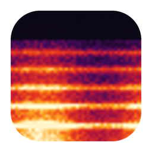
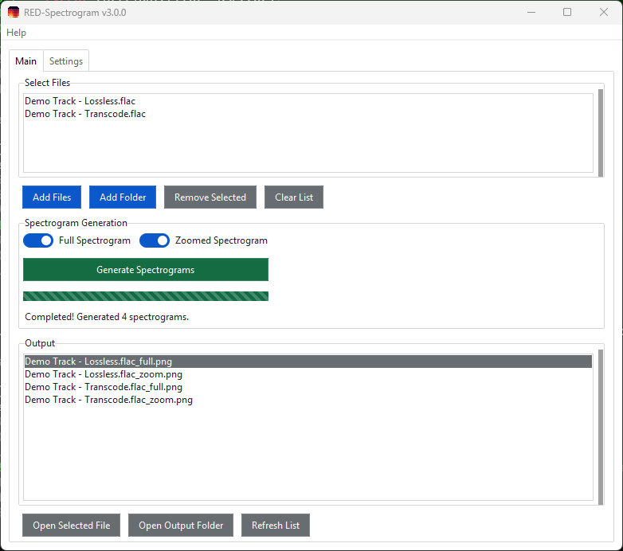
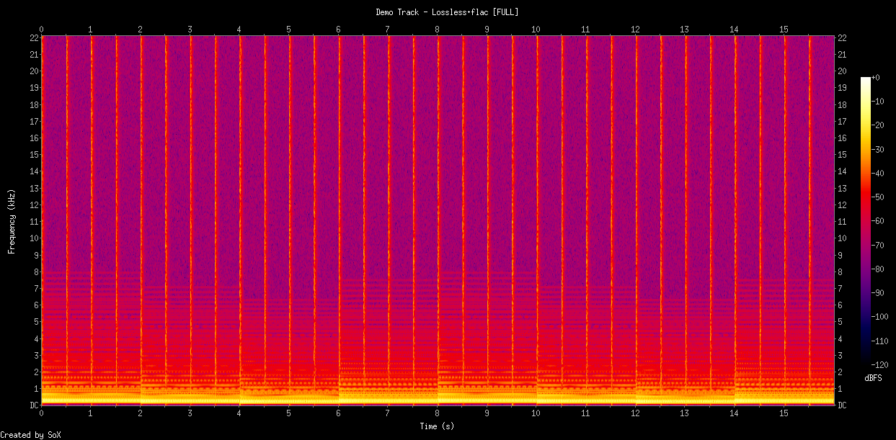
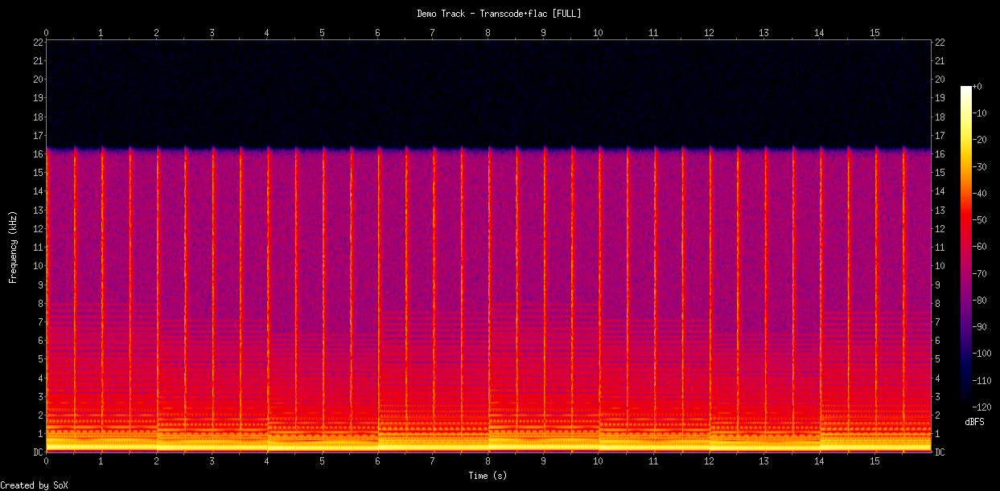
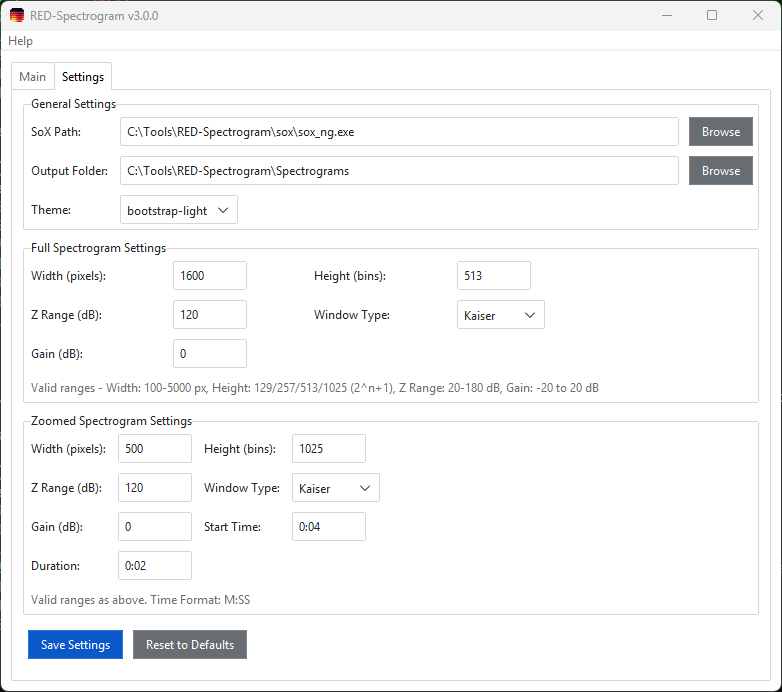
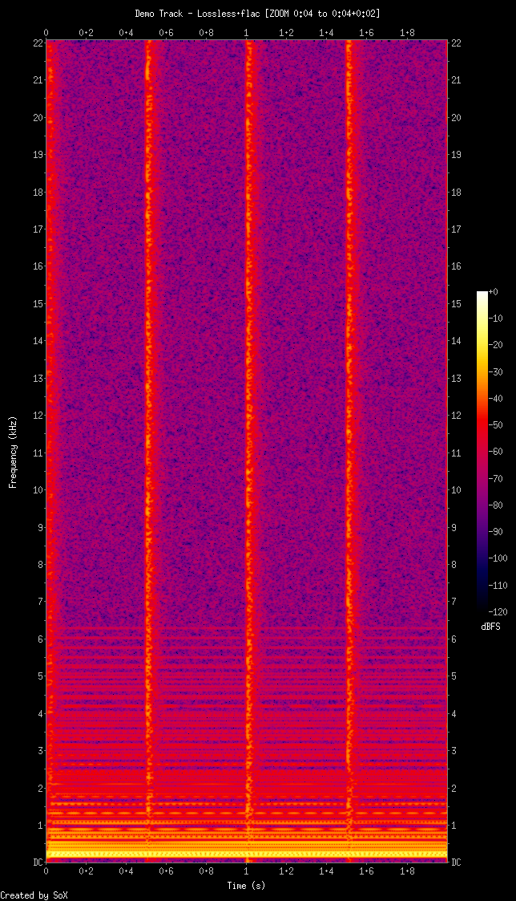

<div align="center">



# RED-Spectrogram

**Generate high-quality spectrograms from lossless audio files — and spot fake FLACs at a glance.**

[](https://github.com/H4Z4RD-H42/RED-Spectrogram/releases/latest)
[](https://github.com/H4Z4RD-H42/RED-Spectrogram/releases)
[](https://github.com/H4Z4RD-H42/RED-Spectrogram/actions/workflows/ci.yml)
[](LICENSE)
[](#download)

[**⬇ Download for Windows**](https://github.com/H4Z4RD-H42/RED-Spectrogram/releases/latest) · [Features](#features) · [How to use](#how-to-use) · [FAQ](#faq) · [Contributing](CONTRIBUTING.md)

<br />

<picture>
  <source media="(prefers-color-scheme: dark)" srcset="docs/images/main-dark.png" />
  
</picture>

</div>

## Why RED-Spectrogram?

A FLAC file is only as good as its source. When a lossy file (MP3, AAC…) is converted to FLAC,
the file *looks* lossless but the high frequencies thrown away by the lossy encoder are gone for good.
A spectrogram makes this visible instantly:

| Genuine lossless | Lossy transcode |
|:---:|:---:|
|  |  |
| Content all the way up to 22 kHz | Hard cutoff at ~16 kHz: a sign of a lossy source |

RED-Spectrogram wraps the excellent [sox_ng](https://codeberg.org/sox_ng/sox_ng) in a simple desktop
app, so you can check whole albums in a couple of clicks instead of typing SoX commands.

## Features

- 📊 **Full and zoomed spectrograms** — see the whole track, or a few seconds in fine detail
- 🎧 **FLAC, WAV and AIFF** support
- 📁 **Batch processing** — add many files at once or scan a whole folder
- 🎛️ **Tunable output** — width, height, dynamic range, gain and FFT window type
- 🎨 **Light and dark themes**
- 💾 **Remembers your settings** between sessions
- 📦 **Portable** — no installation, sox_ng included, runs from any folder or USB stick

## Download

1. Download **`RED-Spectrogram-…-windows-x64.zip`** from the [latest release](https://github.com/H4Z4RD-H42/RED-Spectrogram/releases/latest).
2. Extract the zip anywhere (e.g. your Desktop or `C:\Tools`).
3. Run **`RED-Spectrogram.exe`**.

That's it: sox_ng is already included in the `sox` folder.

> [!NOTE]
> The app is not code-signed (certificates are expensive for a free project), so Windows SmartScreen
> may show a warning the first time. Click **More info → Run anyway**.
> Every release is built publicly by [GitHub Actions](https://github.com/H4Z4RD-H42/RED-Spectrogram/actions/workflows/release.yml);
> see [SECURITY.md](SECURITY.md) to verify your download.

## How to use

1. **Add files** — click **Add Files** or **Add Folder** to pick FLAC/WAV/AIFF files.
2. **Choose the type** — *Full Spectrogram*, *Zoomed Spectrogram*, or both.
3. **Generate** — click **Generate Spectrograms**. The progress bar shows where you are.
4. **View** — double-click a result in the **Output** list, or click **Open Output Folder**.

Each spectrogram is saved as a PNG named after the source file, e.g. `track.flac_full.png` and `track.flac_zoom.png`.

<details>
<summary><b>Settings reference</b></summary>
<br />

<picture>
  <source media="(prefers-color-scheme: dark)" srcset="docs/images/settings-dark.png" />
  
</picture>

| Setting | What it does | Default (full / zoom) | Allowed values |
|---------|--------------|-----------------------|----------------|
| Width | Width of the plot in pixels | 3000 / 500 | 100–5000 |
| Height | Frequency resolution, in bins | 513 / 1025 | 64 or more; 129, 257, 513, 1025… (2ⁿ+1) are fastest |
| Z Range | Dynamic range shown, in dB | 120 | 20–180 |
| Gain | Shifts the 0 dBFS reference to brighten or dim the plot | 0 | −20 to 20 |
| Window Type | FFT window function | Kaiser | Kaiser, Hamming, Hann, Bartlett, Rectangular |
| Start Time | Where the zoomed view begins (`M:SS`) | 1:00 | Within the track |
| Duration | Length of the zoomed view (`M:SS`) | 0:02 | A few seconds works best |

Click **Save Settings** to keep your changes, or **Reset to Defaults** to start over.

</details>

<details>
<summary><b>Example: zoomed spectrogram</b></summary>
<br />

A zoomed spectrogram covers just a few seconds, with more frequency detail:



</details>

## FAQ

<details>
<summary><b>Where are my spectrograms and settings saved?</b></summary>

Next to `RED-Spectrogram.exe`: spectrograms in the `Spectrograms` folder, settings in `spectrogram_config.ini`
and the log in `red-spectrogram.log`. You can change the output folder in **Settings**.

If the app's folder is read-only (for example under `C:\Program Files`), everything goes to
`%LOCALAPPDATA%\RED-Spectrogram` instead.
</details>

<details>
<summary><b>"SoX Not Found" — what do I do?</b></summary>

Make sure the `sox` folder from the zip is still next to `RED-Spectrogram.exe`. If you moved only the
`.exe`, move the `sox` folder too, or point **Settings → SoX Path** to any `sox_ng.exe` or `sox.exe`
on your computer. You can also download sox_ng from **Help → Download sox_ng**.
</details>

<details>
<summary><b>Can it open MP3, ALAC or APE files?</b></summary>

No. The app is meant for checking lossless files, and sox_ng cannot decode ALAC or APE without extra libraries.
Convert them to FLAC or WAV first.
</details>

<details>
<summary><b>Does it work on macOS or Linux?</b></summary>

There is no ready-made download, but the app runs from source on both: install SoX from your package
manager (`brew install sox`, `sudo apt install sox`) and follow [Run from source](#run-from-source).
</details>

<details>
<summary><b>Something went wrong. How do I report it?</b></summary>

Open **Help → Report an Issue** in the app (or [click here](https://github.com/H4Z4RD-H42/RED-Spectrogram/issues/new/choose))
and attach the relevant lines from **Help → Open Log File**.
</details>

## Run from source

Requires Python 3.10+.

```bash
git clone https://github.com/H4Z4RD-H42/RED-Spectrogram.git
cd RED-Spectrogram
python -m venv .venv
.venv\Scripts\activate             # macOS/Linux: source .venv/bin/activate
pip install -e .
python tools/fetch_sox_ng.py       # Windows only: downloads sox_ng into ./sox
python -m red_spectrogram
```

See [CONTRIBUTING.md](CONTRIBUTING.md) for running the tests and building the executable.

## Contributing

Bug reports, ideas and pull requests are very welcome — see [CONTRIBUTING.md](CONTRIBUTING.md).
Changes between versions are listed in the [CHANGELOG](CHANGELOG.md).

## License

RED-Spectrogram is free software released under the [MIT License](LICENSE).
The Windows download bundles sox_ng, which is licensed under the GNU GPL v2; see [THIRD_PARTY_NOTICES.md](THIRD_PARTY_NOTICES.md).

## Acknowledgments

- [sox_ng](https://codeberg.org/sox_ng/sox_ng) and the original [SoX](https://sourceforge.net/projects/sox/) for doing the actual audio processing
- [ttkbootstrap](https://github.com/israel-dryer/ttkbootstrap) for the modern Tkinter themes
- [@mid-ff-play19](https://github.com/mid-ff-play19) for the feature requests that shaped version 3.0
